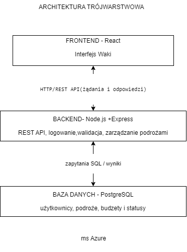

# Waki

## opis projektu

Waki to apka służąca do planowania podróży i zarządzania listą miejsc, które użytkownik chce zobaczyc. Aplikacja umożliwi dodawanie, przeglądanie, edytowanie i usuwanie podróży wraz z informacjami o kierunku, terminie, budżecie oraz statusie wyjazdu. Użytkownicy będą mogli również wyszukiwać i filtrować zapisane podróże 

## funkcjonalnosci

- Rejestracja i logowanie użytkowników
- Dodawanie, edytowanie i usuwanie podróży (CRUD)
- Przeglądanie listy i szczegółów podróży
- Wyszukiwanie i filtrowanie podróży
- Określanie dat, budżetów i statusów wyjazdów
- Walidacja danych i obsługa błędów

## Technologie

- Frontend - React
- Backend: Node.js + express
- Baza danych - PostgreSQL
- Platforma chmurowa: AWS

## architektura

Projekt wykorzystuje architekturę trójwarstwową (3-tier), obejmującą frontend, backend oraz bazę danych

## struktura repozytorium

- `frontend/` – interfejs użytkownika
- `backend/` – logika aplikacji i REST API
- `config/` – pliki konfiguracyjne
- `docs/` – dokumentacja i diagramy

## status projektu

Projekt jest w fazie przygotowania architektury, dokumentacji oraz struktury repozytorium. Implementacja i wdrożenie aplikacji są planowane

## organizacja pracy

Projekt jest realizowany indywidualnie a zadania są organizowane w GitHub Projects
