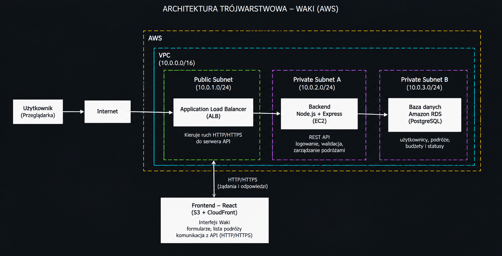

# Waki

Waki to aplikacja do planowania podróży. Pozwala dodawać, przeglądać, edytować i usuwać wyjazdy wraz z kierunkiem, datami, budżetem i statusem.

## Funkcjonalności

- Dodawanie, przeglądanie, edycja i usuwanie podróży (CRUD)
- Formularz z walidacją danych
- Komunikaty ładowania, sukcesu i błędów
- Zapisywanie danych w PostgreSQL przez REST API

## Technologie

- Frontend: React, Vite
- Backend: Node.js, Express
- Baza danych: PostgreSQL
- Chmura: AWS EC2 i AWS RDS

## Architektura

Przeglądarka → React/Vite na EC2 → Express REST API na EC2 → PostgreSQL w prywatnej bazie AWS RDS.

## REST API

| Metoda | Endpoint | Opis |
|---|---|---|
| GET | `/api/health` | Sprawdzenie połączenia z bazą |
| GET | `/api/trips` | Lista podróży |
| GET | `/api/trips/:id` | Szczegóły podróży |
| POST | `/api/trips` | Dodanie podróży |
| PUT | `/api/trips/:id` | Edycja podróży |
| DELETE | `/api/trips/:id` | Usunięcie podróży |

Pola podróży: `destination`, `startDate`, `endDate`, `budget`, `status`.

Dozwolone statusy: `planned`, `confirmed`, `completed`.

API obsługuje kody HTTP 200, 201, 400, 404, 500 i 503.

## Uruchomienie

Wymagane: Node.js 22, npm i dostęp do PostgreSQL.

1. Sklonuj repozytorium.
2. Skonfiguruj `backend/.env` według `backend/.env.example`.
3. Uruchom backend:

   cd backend
   npm install
   node server.js

4. W drugim terminalu uruchom frontend:

   cd frontend
   npm ci
   npm run dev

Frontend korzysta z `/api`, które Vite przekierowuje na backend na porcie 3000.

## Struktura projektu

- `frontend/` – interfejs React
- `backend/` – REST API i połączenie z bazą
- `docs/` – diagram architektury

## Status projektu

Operacje CRUD zostały przetestowane w przeglądarce z bazą PostgreSQL na AWS RDS. Frontend i backend zostały uruchomione testowo na instancji EC2.

Projekt jest realizowany indywidualnie.
